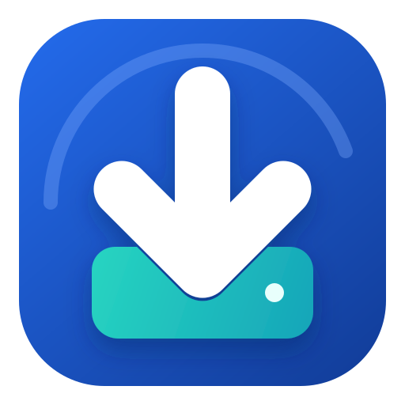
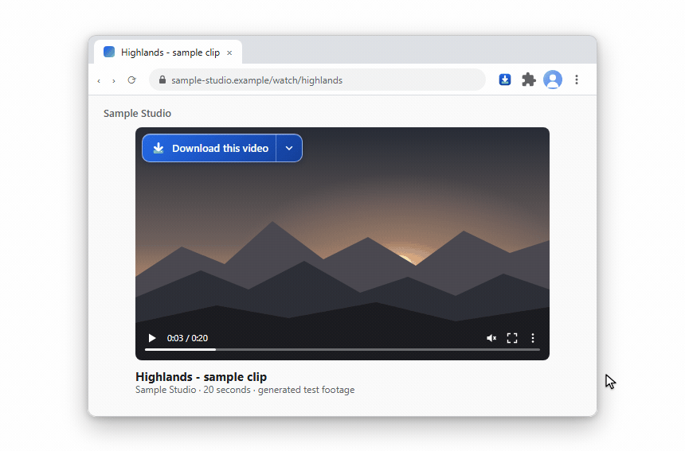
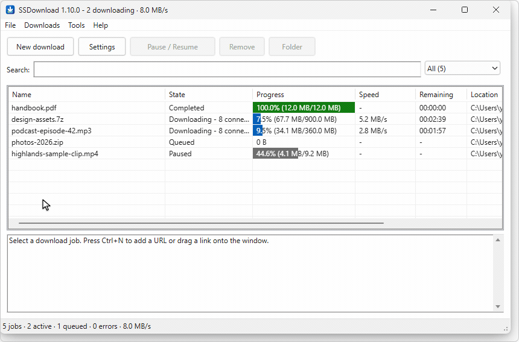
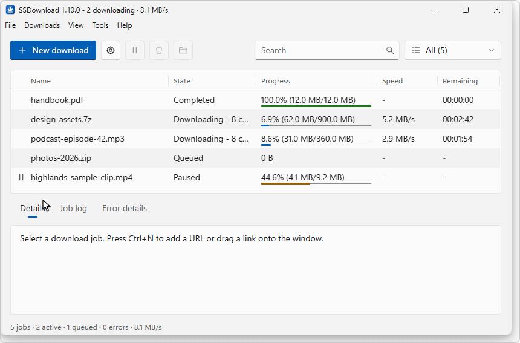

<p align="center">
  
</p>

<h1 align="center">SSDownload</h1>

<p align="center">
  A Windows download manager for files, video and audio. A browser extension adds a download button to videos and sends the media to the app.
</p>

<p align="center">
  <a href="https://github.com/isolmaz/SSDownload/releases/latest"></a>
  
  <a href="https://github.com/isolmaz/SSDownload/actions/workflows/ci.yml"></a>
  <a href="LICENSE.txt"></a>
</p>

<p align="center">
  
</p>

## Features

- **Downloads** over up to 16 connections per file (8 by default). A download resumes only when the server proves the file is unchanged, and a finished file never overwrites an existing one. A file downloaded over HTTP(S) is checked against the SHA-256 its source publishes, when there is one.
- **Video and audio** from the page you are watching: choose the quality, container, audio and subtitle tracks, or save as MP3. Every result is checked with ffprobe and FFmpeg before it is published. Live streams are recorded, from their beginning where the site keeps it, and a live video recording can be finished early with what was recorded so far.
- **Browser extension** for Chrome and Edge: a download button on videos, right-click entries and optional download takeover.
- **Queue:** drag to reorder, pause and resume, speed limits, a mini panel, completion cards and tray controls.
- **Themes:** Classic (the default) and Modern, each in light and dark.
- **For larger jobs:** named queues with time windows, folder rules, batch ranges, a site explorer, a command line and signed updates that install after you accept them.
- **Privacy:** no account, no telemetry and no SSDownload server. The app connects only to the sources you download from and to GitHub, for updates and media support. See [PRIVACY.md](PRIVACY.md).

<p align="center">
  
</p>

<p align="center">
  
</p>

## Install

1. Download **`SSDownload-<version>-Setup.exe`** (or the portable ZIP) from the [latest release](https://github.com/isolmaz/SSDownload/releases/latest) and run it. No administrator rights are needed.
2. The installer adds the browser extension to Chrome and Edge. The next time you open the browser, click **Enable extension** on its "New extension added" notice. No notice? Add it from the [Chrome Web Store](https://chromewebstore.google.com/detail/hgndggnlfpnflkmnbddmcnfniamckham), or use **Tools → Browser setup** to load the bundled copy without the store.
3. The installer downloads media support (yt-dlp, FFmpeg, Deno), each file verified against its published SHA-256. Without a connection, the app installs it on its first start instead.

The builds are not code-signed yet, so SmartScreen may warn on first run. The release page lists the SHA-256 of every file. Installed copies update themselves after you accept the signed update.

The app speaks **Turkish, English, Arabic, Spanish, Portuguese (Brazil), French and German**. It starts in your Windows display language (English when Windows uses another one), and **Settings → General** switches it. In Arabic the windows are laid out right to left. The browser extension, the command line and the installer speak the same languages. The extension and the command line follow the app's choice; the extension's name and summary in the store and on the browser's extensions page follow the browser's language.

## Documentation

| | |
|---|---|
| [User guide](docs/GUIDE.md) | Menus, settings, shortcuts, recovery and the command line |
| [Privacy](PRIVACY.md) | What is stored, and the only connections the app makes |
| [Security](SECURITY.md) | Security model and how to report a vulnerability privately |
| [Contributing](CONTRIBUTING.md) | Building from source, local checks and code layout |

## Build from source

Requires Windows 10/11 x64, the Visual Studio C++ Build Tools and [rustup](https://rustup.rs).

```powershell
cargo build --release --locked
```

Checks run locally with `scripts\check.ps1` and on every pull request in GitHub Actions. See [CONTRIBUTING.md](CONTRIBUTING.md) for details.

## License

[MIT](LICENSE.txt). yt-dlp, FFmpeg and Deno are not bundled; the app downloads them from their GitHub releases (FFmpeg from the BtbN builds). See [THIRD-PARTY-NOTICES.txt](https://github.com/isolmaz/SSDownload/blob/main/THIRD-PARTY-NOTICES.txt).

Download only content you have the right to download. DRM-protected streams are not supported.
